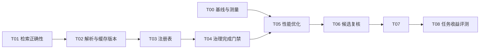

# Memory Curator 迭代开发交付文档

> 文档状态：R1 已验收（含一项经用户确认的性能例外，详见第 9.2 节）；R2 离线设施与 45 次先导已完成；正式 180 次效果验收未完成。R1 验收确认：2026-09-09。
> R1/R2 代码基线：`3b10b7a5913f0f009b91b73f08230fb977344e5d`；该基线 plugin 版本 `0.1.0`；当前源码 plugin 版本 `0.2.0`（见第 10.4 节）。
> 本文件是此次迭代的唯一需求、技术决策、任务与验收入口。复核结论直接更新本文件，不另建平行计划或 TODO。
> 本次交付包含 R1 实现、回归、性能证据、R2 离线评测设施及第 9.6 节的 45 次先导证据；尚未证明策展优于原记忆的正确率或成本，安装发布未执行。
> 2026-09-09 补充：R2 已加入完整实验摘要绑定，报告升级至 schema 2；自测与补强证据见第 9.5 节；新增独立先导 45/45 已评分（第 9.6 节），原始 placeholder 模板历史记录保持 0/180，正式验收仍未完成。

## 1. 交付目标与范围

目标用户是使用项目 Markdown 记忆的开发者及 Agent。成功标准同时包含：记忆不会因维护被损坏、召回结果可追溯到当前库、普通读取延迟有界、记忆确实帮助完成任务。

| 迭代 | 交付内容 | 完成边界 |
|---|---|---|
| R1：可靠性与性能 | 修复确定缺陷、统一必要的文档解析契约、保留新鲜度检查并减少重复工作、建立可复现性能基线 | T00–T07 全部验收，回归与性能报告齐备；不以测试条数代替结果验收 |
| R2：效果验证 | 固定任务集、无记忆/原记忆/策展后记忆对照协议、离线结果聚合与决策报告 | T08 完成；区分评测设施完成与实际效果已验证 |
| 后续候选 | 证据变化复核、可撤回策展、记忆转为测试/文档、上下文预算交付 | 仅定义实验与开工条件，不属于 R1/R2 的默认实施范围 |

R1 不引入新常驻服务、文件监听、Redis、ANN、向量数据库、自动模型调用或新的默认第三方依赖。不自动安装插件、下载模型、访问真实记忆库或发起远程 embedding。实现与发布分别验收；本文件不授权发布或真实记忆删改。

现有行为权威仍为 [缓存与检索架构](../../plugins/memory-curator/skills/memory-curator/docs/memory-cache-architecture.md)。该文档与本次已实现行为同步。

## 2. 审查证据与问题清单

审查覆盖核心 Python、shell 入口、Skill、治理规则、安装/hooks、测试、评测和 POC 边界。基线 `bash tests/run.sh` 的 60 个单元测试及 shell 回归通过。以下 F01–F09 在本次会话内使用临时合成语料复现；临时语料已清理，T00/T01 等任务负责形成仓库可重复执行的证据。

下表的脚本路径均相对 `plugins/memory-curator/skills/memory-curator/scripts/`。

| ID | 现象与影响 | 当前入口 | 归属 |
|---|---|---|---|
| F01 | command 向量库的 keyword 查询仍要求并执行 embedding；未提供 adapter 则失败 | `memory_search.py::search_memory` | T01 |
| F02 | A 库连同索引复制到 B 后，查询 B 返回 A 的绝对路径；A 后续内容不在 B 的校验范围 | `memory_search.py::search_memory` | T01 |
| F03 | 数据库名 `backup#1.sqlite` 导致查询打开错误 URI，并创建零字节 `backup` 文件 | `memory_search.py::search_memory` | T01 |
| F04 | 更新多行 YAML 列表只替换首行，遗留旧列表项；自制 parser 掩盖了损坏 | `memory_metadata.py::update_frontmatter` | T02 |
| F05 | metadata 中显式 null/空列表被 `or legacy_value` 覆盖，旧期限/替代关系无法清空 | `memory_index.py::build_index` | T02 |
| F06 | 缺 layer 的 legacy note 不进入注册表任何分组；覆盖成功后成为 orphan | `memory_registry.py::render_registry` | T03 |
| F07 | 缺 description 时 summary 读取完整注册行，连续重建重复叠加链接前缀 | `memory_index.py::summary_for_note` | T03 |
| F08 | governance 失败仍可 mark；detector 无提醒，而过期 note 已从 route 排除 | `mark-curated.sh`、`hooks/detect-memory-health.sh` | T04 |
| F09 | 两条正文均有无关否定句时，核心规则相反仍不阻断；实测相似度 0.960784 | `memory_index.py::preflight_candidate` | T06 |
| F10 | 健康模板允许 `freshness=unknown`，治理枚举不允许；L0–L3 使用语义不足 | `references/judgment-matrix.md` | T04、T07 |
| F11 | installer 的 `jq … && mv …` 失败可能仍输出成功并退出 0；静态发现，实施前补复现 | 根目录 `install.sh` | T07 |

F09 是启发式覆盖不足，不意味着可以实现“证明不存在语义冲突”的门禁。T06 收紧高相似候选的复核流程，并限制成功信息的含义。

## 3. 性能证据、预算和测量契约

### 3.1 实施前的探索性基线（保留审查出处）

本节为制定方案时的探索数据；最终验收使用第 9 节 T00 正式基线与候选报告，不将不同计时方法的结果直接比较。

环境：macOS ARM64、Python 3.11.3、每条约 2KB、中英混合合成文本；30/300/1000 条正文总字节数分别为 59,100 / 596,220 / 1,992,020。每项 20 次、先预热、文件缓存为 warm；CLI 每次启动新 shell/Python 进程，执行顺序交错。向量为本地 `local-hash` 1024 维，仅用于成本测量，不代表语义质量。

| 条数 | route P50 / 样本 P95 | 无向量库 keyword P50 / 样本 P95 | 向量库 keyword P50 / 样本 P95 | hybrid P50 / 样本 P95 |
|---:|---:|---:|---:|---:|
| 30 | 61.85 / 65.79 ms | 69.21 / 74.17 ms | 72.61 / 76.66 ms | 72.45 / 76.63 ms |
| 300 | 90.36 / 95.80 ms | 89.69 / 94.13 ms | 122.14 / 128.11 ms | 121.55 / 130.10 ms |
| 1000 | 179.25 / 188.04 ms | 152.98 / 159.28 ms | 261.00 / 273.66 ms | 262.05 / 268.15 ms |

1000 条库的独立阶段中位数：内存索引重建 87.22 ms、strict check 107.29 ms、字段匹配排序 17.96 ms、FTS 排序 1.47 ms、本地向量排序 108.21 ms。一次 keyword / local-hash 索引构建分别为 311.68 / 695.04 ms；构建只测一次，不作为稳定性能结论。

另一次 1000 条诊断样本中，搜索现有 fingerprint 路径为 83.08 ms；只读完整源内容并计算相同指纹、跳过元数据解析为 21.35 ms，样本 hash 相同。这是候选优化的局部证据，不是已实现的端到端提速。

限制：这些数据未包含冷磁盘缓存、MCP/工具调度、模型推理、网络、真实 embedding；没有峰值 RSS 或真实任务质量数据。不能宣称生产 P95、容量上限或语义检索收益。route 返回 top-3 仍读取全库正文，实测 1000 次 note 读取；省上下文不等于省本地 I/O。

### 3.2 R1 验收预算

以下为实施目标，不是当前跨设备 SLA。以 T00 固定的参考机器、同一 Python、同一语料和同一方法比较，其他硬件单独报告。

| 项目 | 目标 |
|---|---|
| 300 条 × 约 2KB 的 route / keyword CLI | 每个验收批次样本 P95 ≤150 ms |
| 1000 条 × 约 2KB 的 route / keyword CLI | 每个验收批次样本 P95 ≤300 ms |
| 1000 条本地 1024 维 hybrid CLI | 每个验收批次样本 P95 ≤350 ms；不含远程调用 |
| keyword 的额外调用 | embedding、向量扫描、LLM 调用均为 0 |
| 性能改动的收益 | 同机配对测量超出基线噪声；仅为加速的改动，目标阶段 P50 至少改善 10%，端到端不得出现超过 10% 的稳定退化 |
| 常驻资源 | 默认无守护进程、无额外模型驻留；新增缓存必须说明实际内存成本 |
| 新鲜度 | 不跳过源内容校验，不使用静默 TTL/mtime 近似替换 |

不把一次噪声尖峰作为单测失败。参考机执行 3 个独立批次，每个场景至少 30 个计时样本；P50 使用中位数，P95 使用 nearest-rank（升序第 `ceil(0.95*n)` 个样本，1-based）。保留原始样本、环境、语料 hash 与批次结果。预算失败先定位，不通过更改阈值、缩短正文或少校验字段获得“通过”。低影响正确性修复不要求带来 10% 提速，但仍不得引入稳定性能退化。

优化判定采用相同场景的配对批次：3 个批次的目标阶段 P50 改善均 ≥10%，且三者中最小改善率大于基线三个批次 P50 的 `(max-min)/median`，才称为超出本次噪声的收益；否则结果为 inconclusive，不能宣布提速。端到端 P50 或 P95 在至少 2/3 配对批次变慢 >10% 视为稳定退化。预算要求每个批次通过；任何查询失败、超时、错误结果或不属于该策略的降级均使该场景不能达标，必须单列，不能从样本中删掉后只汇总成功请求。这是固定环境的工程门槛，不是统计显著性检验。

### 3.3 T00 测量口径

1. **CLI end-to-end**：从创建子进程到退出，覆盖启动、校验、检索与 JSON 输出；stdout/stderr 经固定 PIPE 捕获并用 communicate 等待退出，核验退出码及结果在计时外进行。避免带 timeout 的 wait 轮询把进程回收睡眠误算成查询耗时。
2. **library query**：同进程公共查询函数，仍包含其正常的新鲜度校验。与 CLI 分列。
3. **retrieval kernel**：预构建且验证的同一个快照上，仅计字段匹配、FTS 或向量排序。必须标明排除构建、源校验和连接的边界，不能拿它冒充在线延迟。
4. **build**：JSON、FTS、local-hash 分列全量重建；远程 provider 未测时记录 `not_measured`，不能填 0。

现有 `curator-keyword` 实为字段匹配器，构建在计时外；SQLite adapter 每次校验在计时内。保留旧 adapter 名称用于兼容，但报告增加明确的 algorithm 与 timing_scope。新增 `curator-fts` 名称用于 SQLite keyword 比较，不能改名后悄悄改变旧 adapter 语义。

测试语料由固定 seed/规则生成，至少包含 30/300/1000 条约 2KB 标准场景、100 条约 20KB 长 note 场景、中英混合查询、无匹配查询、active/inactive/overdue 混合过滤场景。每个场景的查询和状态比例固定；标准预算表只适用于前述 2KB 场景，其他场景报告而不伪套阈值。向量额外测 256/1024 维；local-hash 与远程模型结果严格分开。

性能报告最少包含：基线 commit、当前工作区 diff 标识/是否 dirty、Python/OS/CPU、数据库与 SQLite 版本、语料生成器版本/seed/hash、条数/正文总字节/维度、algorithm、timing_scope、cache 状态、warmup/repetitions、原始毫秒数组、P50/P95、`percentile_method=nearest_rank`、返回结果摘要、provider 身份、网络是否启用。CPU/RSS 没有可靠采样时写 null 与原因。现有质量 benchmark 的 rounded-index 分位数保留并标注 `percentile_method=legacy_rounded_index`，不在兼容字段中静默换算法，也不拿该值代替 T00 的发布性能判断。

## 4. 技术决策与不变量

### D01：继续以 Markdown 为权威，注册表仍需成对维护

保持 note + `MEMORY.md` 的当前管理边界；JSON/SQLite 是可重建派生数据。R1 不把任意旧注册表直接降级为可丢弃缓存，因为 legacy 摘要可能只存在于注册表。重建必须保留合法的人类 label，并可靠提取已有摘要；不能因 parser、分组或模板限制丢入口。

### D02：统一有限 frontmatter 契约，不实现通用 YAML 平台

已新增一个无 I/O、无外部依赖的内部模块 `scripts/memory_frontmatter.py`，供 index 读取器与 metadata writer 共同使用。它只承担 frontmatter 边界、支持的 scalar/list 解析和 metadata 字段范围替换；字段优先级与治理业务由消费方处理，不承担文件定位、索引发布或搜索。

保留现有 `memory_index.parse_frontmatter(text)` 调用入口，委托到共享模块，减少消费者改动。支持范围必须有明确文法和 fixture：顶层 scalar、一个 `metadata` mapping、scalar/空值、现有 flow list、标准多行 scalar list。现有 `[AGENTS.md, docs/a.md]` 与 writer 输出的 JSON 风格引号/转义数组都必须正确解析；引号内逗号不是分隔符。

支持 LF 与 CRLF，边界必须为独占一行的 `---`；支持整行注释及引号外的行尾注释。重复 key、tab 缩进、锚点/别名/tag、嵌套对象列表、block scalar 等未支持形式返回文件/行号和明确原因；不静默误读、不自动重写。未知 scalar/list 字段的原文和未编辑正文必须保留；未知复杂结构同样明确拒绝，不把无法解释的内容当成缺失。没有 frontmatter 的 legacy note 仍可按当前读取模式建立元数据；metadata apply 继续在写前拒绝没有可编辑 frontmatter 的 note。

字段解析采用“是否存在”优先级：metadata 中存在 key 就使用其值，否则使用顶层 legacy key，否则使用现有默认。`null` 和 `[]` 是明确值。`review_after/superseded_by` 的 null 表示清空，空字符串拒绝；`supersedes/evidence_refs` 的 null 归一化为空列表，`[]` 同样清空。`scope/entities` 显式空列表不得再触发关键词自动提取，只有字段缺失才提取；人工 `links=[]` 不抹除正文实际存在的 wiki links。非空枚举/域字段的 null 交给治理报错，不偷偷回退旧值。未知业务类型值不在本次新增枚举限制，例如现有 `type=workflow` 用例应保留。

外部 JSON manifest 的标量字段接受 string 或按上表允许的 null；集合字段接受 string list 或允许的 null。bool、number、dict、嵌套 list 非零拒绝，不能经 `_yaml_value` 转字符串后当成成功写入。非可空字段的 null 在 apply 准备阶段拒绝；手工 Markdown 中同类非法值由治理诊断。

metadata writer 替换整个字段节点范围（首行及其多行列表），只改授权字段；在准备所有文件完成后才发布。生成内容必须能由共享解析器读回，并与 manifest 的目标字段值一致。保留现有 dry-run、全库 manifest 覆盖检查、符号链接拒绝、mode/xattr 保留及异常回滚。无改动文件不写回，正文及无关字段的字节变化需被测试拒绝；如果无法安全保持原换行格式，应在写前拒绝，不能隐式格式化整篇。

### D03：解析语义升级使旧派生索引失效

JSON `SCHEMA_VERSION` 从 3 升至 4。SQLite 使用命名常量 `SEARCH_SCHEMA_VERSION=2`，manifest 新增 `source_index_schema`，构建时写入当前 JSON schema。搜索首先验证这两个 manifest 版本，再计算源 hash、召回或调用 adapter。

旧 JSON/schema 3、旧 SQLite/schema 1、缺少 `source_index_schema` 或值不匹配时非零退出，提示显式重建；不迁移或修改 note，不在 query/check 内自动 rebuild。语义升级后的源码 hash 不变，也不能复用旧 SQLite 中的过期解析字段。

保持现有 corpus hash 输入约定，不因重构顺便改算法：note 使用 `read_text(encoding='utf-8')` 的换行规范化结果重新 UTF-8 编码后 SHA-256，`MEMORY.md` 使用原始 bytes hash；文件名排序与当前 JSON 序列化保持一致。新 schema 提供解析版本边界，不再额外发明内容版本服务。

### D04：按策略执行必要召回，返回当前库路径

| 请求 strategy | 必须执行 | 明确行为 |
|---|---|---|
| keyword | 校验 + FTS | 不要求 embedding command、不访问向量、不执行远程请求 |
| vector | 校验 + vector | vector 有结果时不算 FTS；当前缺向量的显式 keyword 降级保留 |
| hybrid | 校验 + FTS + vector | 保留 RRF 权重、候选数量、排序及过滤语义 |

adapter 超时、provider/model/fingerprint/dimensions 不匹配仍硬失败；不能把 adapter 故障当作“无向量”降级。保留 `strategy_requested/strategy_used/degraded_from/warning` 字段。vector/hybrid 的既有显式缺向量降级继续排除在语义成绩外。

SQLite 只读连接由 `db_path.resolve().as_uri()` 生成正确编码 URI，再追加 `mode=ro&immutable=1`。数据库不存在时失败且不创建文件。结果 `path` 从当前库目录与已验证的相对 note 文件名构造，不使用构建时的绝对路径。读取兼容可暂留旧 `path` 列，但禁止再作为权威；不为此单独做表结构迁移。

拒绝带目录穿越/绝对路径的结果 file；符号链接若解析到库外则失败，不把其当成“当前库内已校验内容”。这一检查只约束结果追溯，不宣称解决任意并发编辑；消费者在下一次打开文件前内容仍可能变化，现有工具不是跨文件事务快照。

### D05：减少计算，保留新鲜度语义

- 搜索新增专用 `current_corpus_fingerprint(memory_dir)`，只枚举所需文件并计算上述内容指纹；不调用 `build_index`，不解析 frontmatter、不提取关键词、不执行 `date.fromtimestamp`。仍读取全部源内容。
- strict check 继续重建并比较派生字段，不能替换为 hash-only；成员判定用预构造 set，将两个循环从 O(N²) 降为 O(N)。输出问题类型与顺序保持稳定。
- route 使用此次 `check_index` 已返回的 index，避免再次加载 JSON；每次请求统一取一次 today 并传入到期筛选，避免逐 note 调系统日期和跨午夜同批判定不一致，下一请求重新取日期。缺索引的临时构建与 `--rebuild` 的不落盘语义保持不变。
- 关键词提取复用不变的停止词 frozenset 与预编译分段正则，保留原 token 顺序、过滤与评分。节省重复集合构造和正则包装分派；Python re 本身已有编译缓存，不能将收益描述为每次省去正则编译。
- 不在本轮默认引入跨调用文本缓存、mtime 快路、TTL、top-k-only 校验或 session 缓存。它们不能维持当前对全部内容变化的拒绝语义。
- 共享解析器仅在写入路径收集 source spans 和换行样式；读取路径复用同一文法，跳过编辑专用信息。每行缩进只计算一次，标识符标量走等价快路，未加引号的 flow-list token 用预编译分隔符正则线性扫描；没有 LRU、全篇文本缓存或放宽语法拒绝规则。独立解析微测与端到端结果分开报告。
- preflight/build 的重复读入只在已有数据自然可复用且测量有收益时处理，不为减少一次读取增加常驻整库对象。向量 heap/二进制化、embedding 缓存与并发均留待 profile 证明需要。

### D06：成功标记只代表实际通过的门禁

`mark-curated.sh` 依次运行 strict 与 governance，两者均成功才写 `last_curation_epoch/sha`；任一失败时 `.curator-state` 原字节不变，保留 cooldown key。它仍不证明所有内容语义真实。

detector 对 active 且 `review_after` 已过期给出结构化到期信号。复用治理解析/日期规则，在一次 detector 执行中共享需要的索引结果，避免为到期信号额外全库解析；可以给现有 inventory 增加专用 health 输出参数，不新增服务。当天 `review_after == today` 保持当前未过期语义。只读探测器继续 0=未达提醒阈值、10=有提醒；缺失运行依赖/无法定位目录应 fail safe，兼容 hooks 始终不阻断用户 Stop/push。

### D07：preflight 是候选复核门禁

继续返回 exact_duplicates、similar_candidates、potential_conflicts 和 blocking；保留现有 hash/receipt/acknowledge 接口。新增 `assessment_scope='heuristic'`、`review_required_files` 与逐文件原因（exact_duplicate/high_similarity/potential_conflict）。

任何达到当前 similarity_threshold 的候选进入复核队列并阻断未 acknowledge 的新增；不再要求全文 negation 布尔值必须不同。检测覆盖全库，显示 limit 仅限制摘要展示，不能截断阻断集合。判断为高相似不代表语义矛盾，条件不同的合理并存经读正文确认后仍可 acknowledge。`blocking=false` 的文案只能表示未命中该启发式规则。

不增加线上 LLM 判断。若标注样本显示复核负担明显增长，应调整本任务的候选提取方式并重测；不能未经评测直接把“高相似”改名为“已确认冲突”。

## 5. 实施任务与依赖

任务清单仅在本节维护。下列完成项对应本次实现与第 9 节验证证据；R2 正式效果验收仍未完成，45 次先导的有限结论见第 9.6 节。



可并行准备 T00 测量工具、T01 检索缺陷、T02 的独立解析模块与测试。T01 与 T02 的 schema 门禁都需要修改 `memory_search.py`，先合并 T01，再完成 T02 集成。T03/T04/T05/T06 共享 `memory_index.py`，按 T03→T04→T05→T06 串行集成，不允许并发覆盖。此顺序包含文件写入协调要求，不意味着这些能力在业务上必须强耦合。文档、fixture 设计和独立测试设计可并行。

### T00 — 固定性能基线与公平计时

依赖：无。主要文件：`tests/benchmark_memory_performance.py`（已新增，名称不匹配单测发现规则）；现有 `memory_benchmark.py` 及其测试。

实施：按 3.3 节提供独立测量入口，不在 `tests/run.sh` 默认运行耗时压测；调整质量 benchmark 的算法/计时标识，补 `curator-fts`，保留旧 adapter 名称和旧报告字段。新性能报告使用 `report_schema_version=1`；无效退出、错误结果、缺失 provider 或未测阶段不能记为成功 0ms。

- [x] 标准语料生成可重复，原始样本与 corpus hash 随报告保存；临时库不写真实项目记忆。
- [x] baseline 与 candidate 同机、同语料、同维度/策略/样本数，明确 warm 文件缓存与 fresh process。
- [x] 至少一份基线报告覆盖全部标准规模，并将冷缓存/远程/RSS未测明确记出。
- [x] 现有质量指标兼容；lexical 与 FTS 不再被同名标签混淆。

验证：Q-BENCH；性能入口按第 7 节目标命令运行。报告进入 `.tmp/`，需交接的最终摘要和报告标识记在本文件，不把大样本数据塞入 Skill。

### T01 — 修复检索策略、路径和只读连接

依赖：无；schema 部分由 T02 接续。主要文件：`memory_search.py`、`tests/test_memory_search.py`。

实施：按 D04 分派；抽取小型连接/结果路径辅助函数即可，不引入 adapter 框架。保留现有调用参数、输出字段、过滤和排序。

- [x] command 索引上 keyword 无 adapter 仍成功；fake adapter 调用次数为 0，向量函数也未执行。
- [x] vector 有结果不执行 FTS；hybrid 与修复前等价，缺向量降级标识不变，adapter 错误不降级。
- [x] A→B 复制含索引后返回 B；修改或移除 A 不影响 B；非法 file/库外结果被拒绝。
- [x] 含空格、中文、`#`、`?`、`%` 的 DB 路径能查询；缺库查询失败；目录前后文件集合和数据库 bytes 不变，无 WAL/SHM/误建文件。

验证：Q-SEARCH；T00 比较同一向量库上的 keyword 前后样本，记录删除无用计算的收益。

### T02 — 修复 frontmatter 读写与空值优先级

依赖：T01 完成后集成；独立解析模块与测试可提前准备。主要文件：已新增 `memory_frontmatter.py`；`memory_index.py`、`memory_metadata.py`、`memory_search.py`；相应 tests。

实施：执行 D02/D03。writer 按字段完整 span 修改；parser 与 writer 共用解释规则；字段读取逐项区分 absent/null/empty，不以 truthiness 判断优先级。

- [x] block list→flow list、空列表清空、quoted comma/转义、null→legacy 清除均得到明确期望值。
- [x] 未知字段/正文不丢，unsupported/重复 key 在写前失败；dry-run、失败批次无持久化改变；未变文件不写回。
- [x] 旧顶层值只在 metadata key 缺失时回退；恢复 active 的无期限 note 可被召回。
- [x] JSON 3 与 SQLite 1/缺少 source_index_schema 即使源 hash 相同也拒绝查询；错误版本不会执行 adapter。
- [x] 显式重建后 JSON 4、SQLite 2/source_index_schema=4 可用；note 与注册表 bytes 不被缓存升级修改。

验证：Q-INDEX、Q-META、Q-SEARCH；共用解析样本以期望字段及原始 bytes 做断言，不仅用 writer 生成再由同一个 parser 自证。

### T03 — 保证注册表覆盖完整且重建幂等

依赖：T02。主要文件：`memory_registry.py`、`memory_index.py::summary_for_note`；registry/index tests。

实施：发布前断言每条 note 恰好进入一个分组。选择明确失败策略：active 缺/非法 layer 或非法 status 时列出文件并失败，保留原注册表；不默认为任意层级。CLI dry-run 输出待处理原因，不声称生成可用注册表。

摘要优先级保持 description→现有 registry 摘要→正文首条有意义内容→现有 empty fallback；registry fallback 必须解析链接后的摘要，支持当前示例中的 `—` 与 `-` 分隔，不能把链接自身再当摘要。保留现有 label。

- [x] legacy 缺 layer、非法 status 均不能成功覆盖成漏项；异常前后 MEMORY.md bytes 相同。
- [x] 合法集合生成后每文件恰好一次；无 description 的 note 连续两次重建第二次 `changed=false`。
- [x] 保留人类 label、原有有意义摘要、mode/xattr；检测发布前注册表漂移并拒绝覆盖。

验证：Q-REGISTRY、Q-INDEX。不得为让门禁变绿而直接删除 legacy fixture。

### T04 — 闭合治理检查、完成标记和到期提醒

依赖：T02、T03；T03 完成后修改公共 index 文件。主要文件：`mark-curated.sh`、`memory_index.py`、detector、规则 reference、`tests/run.sh` 与 fixtures。

实施：按 D06。修正模板，使 freshness 使用实际合法值（timeless/stable/time-sensitive），提供一个可以直接通过 gate 的最小实例。R1 保留 layer 必填，不在 bug 修复中偷偷取消治理要求；L0–L3 暂定义为排序/分类层，解释不等于事实可信等级，具体现有业务定义缺失时不能假装已存在。

现有 good-memory 缺 layer/domain，sandbox high-if-wrong 又缺 evidence/review 日期，不能直接给 mark 加门禁后忽略失败。保留这些 legacy 兼容样本；新增 `tests/fixtures/governed-memory/` 供 mark 成功测试，补一个在临时项目内真实存在的证据文件或明确未来日期。所有到期测试使用注入 today/相对测试日期，避免固定未来日期变成定时失败。

- [x] strict 或 governance 任一失败，mark 非零、state 原字节不变；通过时保留 last_notify_epoch。状态读取错误（grep>1）也不得被当成空状态覆盖，失败清理临时文件；grep=1 的正常无剩余键仍支持重复盖章。
- [x] active 到期 note 产生 detector 提醒；inactive 的历史日期不误报 active 到期；当天未过期。
- [x] detector 一次执行没有为新信号重复解析全库；运行依赖缺失/无法定位仍 fail safe，hooks 不阻断用户操作。
- [x] legacy 样本仍验证读取兼容；governed 样本通过完整 gate；模板真实执行 build/check/governance 后通过。

验证：Q-INDEX、Q-ALL；增加独立 shell 行为用例，禁止只搜索脚本是否包含 governance 命令来替代结果测试。

### T05 — 保持新鲜度契约的性能优化

依赖：T00、T01、T02、T04；治理相关公共 index 改动先集成。主要文件：`memory_index.py`、`memory_search.py`、相应 tests。

实施：按 D05；搜索的 current_corpus_fingerprint 可放在现有 `memory_index.py`，避免新建缓存层。route 复用 validated index；strict membership 改 set。每个独立优化单独测量，不把多个收益混成一个不可归因数字。

- [x] 新旧 fingerprint 在 LF、CRLF、中文、文件名排序、空库、缺 MEMORY.md 的现有支持模式下等价；无效 UTF-8 与不可读文件明确失败。
- [x] note 任意内容变化、保留 size/mtime 的修改、MEMORY.md 修改、新增/删除 note 均使旧侧车失效。
- [x] strict 继续识别派生元数据被篡改，不能因源 hash 未变而放行。
- [x] route 的结果与错误语义不变，缺索引/--rebuild 仍不落盘；每次有效缓存路由只加载必要的一份 JSON。
- [x] 性能验收完成（含 2026-09-09 用户确认的单项例外）：CLI 绝对预算、源验证提速已满足；30 条 library.route 的 >10% 稳定退化按第 9.2 节接受本次交付例外，原门槛保持不变。源内容与字段校验未减少。

验证：Q-INDEX、Q-SEARCH、T00 性能入口；记录单阶段与端到端结果。局部提速不能写成整个查询同倍提速。

### T06 — 高相似写入候选必须显式复核

依赖：T02、T05；共享 index 文件在 T05 后集成。主要文件：`memory_index.py::preflight_candidate/command_preflight`、index tests、Skill 写入段及 eval fixtures。

实施：按 D07。保持原有非零阻断和 --acknowledge 退出语义，添加复核原因；receipt 继续绑定 candidate/corpus hash。该 receipt 是审计信息，不是不可伪造授权令牌，也不自动扩大真实写入权限。

- [x] 双方都有无关否定句而核心规则反向的 0.960784 类样本进入 review_required_files。
- [x] exact duplicate、同义高相似、条件不同的合理并存分别有清晰原因；acknowledge 后仍保留原因，不改写为“无冲突”。
- [x] 高相似候选在 display limit 之外仍阻断；完全无关候选正常通过；自身目标路径按现有约定跳过。
- [x] 无 LLM/embedding 调用；退出成功信息明确仅覆盖启发式检测。

验证：Q-INDEX、至少 6 个上述正反例的行为 eval。复核负担记录在 R2 中，不把“阻断更多”直接当质量提高。

### T07 — 修正文档、安装错误与交接入口

依赖：T03–T06。主要文件：README、canonical SKILL/reference/architecture、根 install.sh、plugin-layout tests；本文件。

实施：把可选 embedding 细节移到一个按需 reference，保留主 Skill 上的数据外发授权、身份校验、显式降级边界。整理 layer/freshness 示例和 schema 重建说明。installer 在 jq 或 mv 失败时非零退出，保留原 settings，不打印 hooks 注册成功，清理临时文件；测试仅写临时 project。唯一已有插件 command 连同 hook/group 的未知选项保持原样，缺失时追加默认；多个命中拒绝歧义并保留配置。

- [x] 临时无效 JSON/settings 结构使 installer 失败，原配置保持不变；正常合并与重复执行不重复 hooks。
- [x] 旧缓存拒绝与显式重建路径在 README 中可执行；没有自动重建承诺。
- [x] Skill 主流程不增加在线模型步骤；引用可达，包装后的相对路径正确。
- [x] README、架构、Skill、模板的完成标准一致；本文件逐项附实现/验证状态。

验证：Q-LAYOUT、Q-ALL；Markdown 内部链接和 shell 代码片段人工核对。不要提前改 plugin version 或执行安装/发布到用户环境。

### T08 — 固定真实任务收益的评测协议与离线聚合

依赖：R1 完成。主要文件：`evals/task-benefit-cases.json`、`scripts/memory_outcomes.py`、`tests/test_memory_outcomes.py`（已新增）；本文件维护评测结论。

选择离线聚合器，职责仅为校验固定 case/run 记录并生成报告；不新增模型调度、凭据处理或自动外发。先建立至少 20 个可共享/合成的任务：无相关记忆、精确约束、过期规则、条件冲突、独特经验各 4 个。真实历史任务需单独确认来源和外发范围，未取得记录时不能宣称其效果已验证。

每个 task 固定三种输入：none、original、curated；各执行 3 次，同模型/设置/任务环境，使用不同全新任务上下文且顺序交错。模型与裁判版本固定并记录；随机 seed 不可控时标记不可控，不能声称确定性。

cases 文件顶层为 `case_schema_version=1/experiment_id/model_config/cases`；`model_config` 包含 `id/ref/hash`，绑定可定位的模型配置记录。case 字段：`id/category/task/environment_ref/environment_hash/required_constraints/forbidden_actions/high_risk/requires_memory/requires_unique_experience/source_refs`，以及 `memory_inputs`：为 original/curated 分别指定 `snapshot_ref/snapshot_hash`；none 明确为无记忆输入且不注入 snapshot。snapshot 包含本任务实际注入内容及来源文件清单，避免 hash 无法定位原输入。所有 variant 的 task 与 environment 必须一致；模型配置、环境描述和快照均是文件，其 hash 统一为原始 bytes 的 SHA-256。

run 字段：`experiment_id/experiment_digest/case_id/variant/repetition/model_config_id/environment_hash/memory_snapshot_ref/memory_snapshot_hash/output_ref/elapsed_ms/input_tokens/output_tokens/token_source/human_correction_count/human_correction_evidence_ref/judgment`。`token_source` 为 provider_usage/tokenizer/unavailable；run 的配置 ID、环境 hash、snapshot 必须与本 experiment 的绑定值一致，none 的 snapshot 字段为 null。judgment 包含 `correct/harmful_memory_use/unique_experience_preserved/reviewer/evidence_ref`；增加可选 `helpful_memory_use: bool|null`，只有明确为 true 且本地判定证据齐备时才支持“有帮助”的结论，缺失不能推定为 false 或 true；case 的 requires_unique_experience=false 时该项为 null 并排除分母，为 true 却缺少判断则是未评状态。human_correction_count 非零时必须提供修正证据引用，缺记录为 null。计数与时间缺失不能算成功或 0 成本。

模型配置文件还声明 `status=fixed/placeholder`、精确 model/settings/reviewer、seed_control/seed、fresh_context_per_run=true 与 run_order=interleaved；placeholder 不会达到 complete。

每条 run 必填 `experiment_digest`。聚合器先验证 cases，并读取模型配置、环境、输入快照及所有声明的本地来源；在读取运行材料前，对完整 manifest 和上述相对路径/原始字节 hash 计算版本化摘要。算法以[评测协议](../../evals/files/task-benefit/README.md#完整实验绑定与迁移)为准。执行前用现有 CLI 和空 runs 取得摘要（incomplete/退出 1 仍返回），固定输入后将它写入新运行。缺失摘要或任何绑定漂移都返回 invalid/退出 2，不按当前输入给旧记录自动补签；无效报告的 digest 为 null。manifest 对象键顺序和工作区根迁移不改变摘要，数组顺序与引用文件原始字节变化会改变；仅作为运行产物/裁判证据的文件不参与，兼作声明输入时仍绑定。

新增 `--workspace` 指定输入快照、任务环境、运行输出与评审证据的路径根。上述本地 ref 必须是相对路径，解析后仍位于该根内且能读取；拒绝路径穿越、库外 symlink、缺失文件或 hash 不符。source_refs 中声明的远程链接仅记录为未验证。聚合器不执行这些文件。`--output` 必须位于只读 workspace 外且不得覆盖 cases/runs 路径；报告在同目录临时文件写完整后原子替换，外部硬链接也不会截断输入。发布失败保留旧报告并清理临时文件。

报告采用 `report_schema_version=2`（2026-09-09 完整绑定升级），含 `binding_schema_version=1/experiment_digest`，包含 `data_status=complete/incomplete/invalid`、`decision=pass/fail/not_evaluated`、各指标的 numerator/denominator/coverage。退出码：0=记录完整且本轮判据通过，1=记录合法但不完整或判据失败，2=输入结构/身份/hash 校验失败。合法报告的 token 或人工修正记录缺失时对应成本比较为 unavailable；不得声称成本收益。模型设置、环境、输出或必要评审证据缺失则整个 data_status 不能为 complete。

- [x] 缺少某个 case 的 run/variant/必要判定时为 incomplete、退出 1；重复运行身份或配置/环境/快照绑定不匹配时为 invalid、退出 2；两者均拒绝生成“验收通过”。
- [x] 完整摘要绑定任务、判据、模型配置和本地来源；即使更新各声明 hash 并复用 ID，旧运行摘要仍会被拒绝。合法新实验、空 runs、工作区复制及纯运行材料变化的回归通过。
- [x] 报告按 case 配对，分别列正确率、有害记忆使用、独特经验保留、人工修正、token 与耗时；召回质量指标单独保留。
- [x] HTTP evidence_ref 只计声明，不计验证成功；区分本地可定位、远程未验证、缺失，不能把 URL 字符串算证据有效。
- [x] 合成运行记录可验证聚合与 incomplete 处理；实际模型结果为空时只交付设施，不声称产品收益。

判定先按 `(case, variant)` 输出三次运行的 correct_count/3，不以一次最优结果代表该 case。任一 high_risk case 的 curated 运行出现错误或 harmful_memory_use=true，或任一要求保留独特经验的 curated 运行判定未保留，则 decision=fail，需具体处置，不用平均正确率抵消。其余要求为：curated 总正确完成次数不低于 original；至少一个 requires_memory=true 的 case，curated 的正确次数高于 none 且有帮助的证据。没有这种帮助证据则 decision=not_evaluated，退出 1，不自动宣称记忆有效。

判据中的 pass 仅代表本固定小样本任务质量过门槛；成本字段缺失时不能宣称成本改善。若只减少 token 却降低正确性，则拒绝该策展方案。调整输入或策展方案后使用新的 experiment_id，保存旧失败记录，不通过重跑挑选三次最好成绩凑通过。20 个 case 仅支持方向判断，不声称统计显著或普遍效果；相同任务的多次运行相关，不能伪装成独立大样本。hash 证明记录绑定一致，真实运行是否遵守上下文边界仍需日志与评审证据。

验证：Q-OUTCOMES（已可用）、Q-ALL；效果验收还需真实运行和人工/独立裁判证据，不能用聚合器单测代替。

## 6. 缓存升级与交付兼容

升级顺序：先完成代码及临时语料回归 → 在副本上验证 cache 重建 → 用户在已授权的目标库中显式 build/check/governance → 按需 build-search-index → 完成 mark。

| 数据/接口 | R1 变化 | 迁移要求 |
|---|---|---|
| note / MEMORY.md | 不做自动数据迁移；明确 null 生效，未知格式可能被明确拒绝 | 单条/批量修改仍需遵循原授权与成对维护；先在副本检查 |
| JSON schema 3 | 升至 4，旧索引拒绝 | 显式 build-index；--rebuild 临时读取不覆盖 cache |
| SQLite schema 1 | 升至 2，并校验 source_index_schema=4 | 显式 build-search-index；不自动调用真实 embedding |
| search/route CLI | 保持现有参数、结果字段及默认调用方式 | 新增诊断字段向后兼容；修复 keyword 的多余调用 |
| preflight | 高相似候选更严格，增加原因字段 | 原有 --acknowledge 仍是显式复核；不把旧 receipt 当新语料许可 |
| mark / detector | 完成门禁加强、到期信号补齐 | legacy 未治理库无法 mark 是预期，给出具体缺失字段 |

回退仅回退代码和派生索引，不覆盖用户后来修改的 Markdown。旧代码需要的 cache 应由对应旧代码显式重建，不能绕过版本门禁。R1 不宣称多文件更新具备 crash-atomic 事务；现有异常回滚也不等于进程崩溃恢复。

## 7. 验证命令与发布检查点

命令从仓库根目录运行。有项目 `.venv` 时优先使用其 Python；当前基线无 `.venv`，`tests/run.sh` 使用 python3。启用 RTK 的环境为命令添加 `rtk proxy`。所有可写测试只使用临时库。

| 标识 | 当前可执行命令 |
|---|---|
| Q-INDEX | `PYTHONDONTWRITEBYTECODE=1 python3 -m unittest discover -s tests -p 'test_memory_index.py'` |
| Q-META | `PYTHONDONTWRITEBYTECODE=1 python3 -m unittest discover -s tests -p 'test_memory_metadata.py'` |
| Q-REGISTRY | `PYTHONDONTWRITEBYTECODE=1 python3 -m unittest discover -s tests -p 'test_memory_registry.py'` |
| Q-SEARCH | `PYTHONDONTWRITEBYTECODE=1 python3 -m unittest discover -s tests -p 'test_memory_search.py'` |
| Q-BENCH | `PYTHONDONTWRITEBYTECODE=1 python3 -m unittest discover -s tests -p 'test_memory_benchmark.py'` |
| Q-OUTCOMES | `PYTHONDONTWRITEBYTECODE=1 python3 -m unittest discover -s tests -p 'test_memory_outcomes.py'` |
| Q-LAYOUT | `PYTHONDONTWRITEBYTECODE=1 python3 -m unittest discover -s tests -p 'test_plugin_layout.py'` |
| Q-ALL | `PYTHONDONTWRITEBYTECODE=1 bash tests/run.sh` |

以下新增入口已可执行，实际测量命令与结果见第 9 节：

```bash
# T00：生成临时语料，测量新进程 CLI 与分阶段成本。
python3 tests/benchmark_memory_performance.py \
  --sizes 30,300,1000 --note-bytes 2048 --dimensions 256,1024 \
  --warmup 3 --repetitions 30 --batches 3 --seed 20260908 \
  --scopes cli,library,kernel,validation \
  --output .tmp/performance-r1.json

# T08：先验证随仓库交付的未运行状态，预期退出 1，不执行模型。
python3 plugins/memory-curator/skills/memory-curator/scripts/memory_outcomes.py \
  --cases evals/task-benefit-cases.json --runs evals/files/task-benefit/runs.unmeasured.jsonl \
  --workspace evals/files/task-benefit \
  --output .tmp/task-benefit-report.json
python3 -m unittest discover -s tests -p 'test_memory_outcomes.py'
```

### R1 检查点

- [x] T00–T07 对应回归覆盖确定触发场景，Q-ALL 通过。
- [x] Markdown 旧格式、显式空值、缓存版本切换、迁移路径均在临时副本验证。
- [x] keyword 零 embedding/向量调用、查询不写文件有可执行证据。
- [x] R1 性能验收完成（含已确认例外）；CLI 绝对预算已通过，30 条 library.route 的稳定退化已于 2026-09-09 经用户确认接受，范围与原始证据见第 9.2 节。
- [x] 代码审查完成，README/Skill/architecture 与实现同步，未实施能力仍标为计划。
- [x] 发布包结构检查通过；实际安装、commit、push、发布按后续授权执行，不能由本清单自动触发。

### R2 检查点

- [x] T08 设施验收通过，固定任务集与记录 schema 可共享。
- [ ] 完整正式协议的执行、人工/独立判定和成本记录齐备后才标记“效果已验证”。已完成独立先导 45/45，其完整协议覆盖为 45/180、not_evaluated；原始 placeholder 模板仍为 0/180，详见第 9.6 节。
- [ ] 每个新增高风险错误均有处置，失败方案不因 token 减少而被接受（正式协议未完整执行；第 9.6 节先导未观察到高风险错误，聚合器已覆盖该拒绝规则）。

## 8. 后续 idea 的有限实验

以下保留方向，不要求开发者在 R1 中自行扩展范围。

| 候选 | 最小技术实验 | 开工证据与停止条件 |
|---|---|---|
| 来源变化驱动复核 | 10 条高风险 note，显式本地 evidence_ref + 内容 hash；维护时生成 changed/unavailable/unchanged 队列 | 先有稳定引用；变化不自动等同错误。多数提醒无帮助则停止，不接常驻监听 |
| 可撤回策展 | 一次授权变更的 before/after bytes、源 hash、diff 和恢复演练；note 与 registry 同批验证 | 先确认非 Git 库的恢复需求。恢复必须拒绝覆盖后来编辑；不能保证则不提供一键 apply |
| 记忆转为测试/文档 | 对 5 条高频规则提出目标测试/项目文档的差异，保留独特原因与来源 | 只有反复使用且可验证的规则进入；无明确目标文件不自动写全局规则 |
| token 预算交付 | 对照全文 top-3 与预算内片段，返回来源、有效期、tokenizer 身份和实际 token 数 | 先证明长 note 成本。没有对应 tokenizer 时不能用 chars/4 冒充硬预算；截断不得丢否定/适用条件 |
| 向量/embedding 加速 | profile 证明计算或远程重建占主导后，分别测精确 top-k、二进制向量、按输入 hash 复用 embedding | 每项独立比较正确率与耗时；缓存 key 覆盖 provider/model/fingerprint/dimensions/输入投影版本。暂不加 ANN 或盲目并发 |

普通读取的长期边界仍是必要内容校验、候选召回和预算内交付。来源复核、LLM 审计、对照实验和恢复材料生成优先放在显式维护阶段；任何改变新鲜度模型的提案须说明会漏掉哪类变化。

## 9. 实施与验收记录

### 9.1 交付状态与功能证据

2026-09-08 已完成本次 R1 功能实现与 R2 离线设施；2026-09-09 用户确认接受第 9.2 节的单项性能例外，R1 总验收完成。R2 正式效果验收未完成，后续先导见第 9.6 节。实现基于 `3b10b7a5913f0f009b91b73f08230fb977344e5d` 的工作区增量；没有 commit、版本升级或发布。以下测试均在临时合成库或仓库固定 fixture 上执行，未维护真实记忆库。

| 范围 | 已实现行为与验证证据 |
|---|---|
| T00 测量 | 新入口区分 fresh-process CLI、library、kernel、validation 和 build；固定语料、原始样本、策略/结果检查、失败保留与身份 hash。质量 benchmark 保留旧算法语义，新增 `curator-fts`。 |
| T01 检索 | keyword 在 command/向量库中零 adapter 和向量调用；vector 有结果跳过 FTS；迁移 A→B 后定位 B；特殊 URI 路径和缺库读取不写文件；非法结果路径拒绝。 |
| T02 解析与写入 | 共享有限文法，按完整字段 span 修改；显式 null/空列表、quoted comma/转义、未知字段、重复 key 和 unsupported 语法均覆盖；LF/CRLF、正文/未知内容不变、批次失败回滚、无改动不写、mode 及真实 macOS binary/empty xattr 保留。读写权限或 xattr 复制失败明确报错。 |
| T02 缓存兼容 | JSON 3、SQLite 1 与缺失 source_index_schema 在同源 hash 情况下仍拒绝；显式重建后 JSON 4、SQLite 2/source_index_schema=4 可用，Markdown bytes 不变。 |
| T03 注册表 | 每条 note 恰好归类一次；非法 status/缺 layer 在发布前失败；连续重建幂等，原 label/摘要/mode/xattr 保留；发布前原始 bytes、文件存在状态发生漂移即拒绝覆盖。 |
| T04 治理与状态 | strict 和 governance 两道门禁通过后才 mark；门禁失败保留 state/cooldown；grep 读取错误不当作空 state 覆盖；detector 在一次解析中同时检测索引漂移和 active 过期，今天到期、inactive 历史日期不误报；缺 Python/jq 仍静默放行 hook。文档最小模板实际通过 build/check/governance/mark。 |
| T05 新鲜度与性能 | fingerprint 保留全部内容读取、换行规范化与排序/hash 契约，检测同 size/mtime 的正文变化、MEMORY.md 原始换行变化、增删文件；strict 继续逐字段比较；正常 route 只加载一次 JSON。一次请求统一到期判定日期，下一请求刷新；跨午夜行为回归先失败、修复后通过。具体耗时见下节。 |
| T06 preflight | 7 个具体案例覆盖精确重复、两条均有否定句的相反规则、同义改写、条件差异、无关内容、展示 limit 之外的阻断、自更新排除。高相似进入复核，acknowledge 后原因/hash 仍保留；未命中不表述为语义无冲突。 |
| T07 安装与文档 | 非法/多个 JSON、hooks 结构、jq/mv 失败均保留原配置或缺失状态并非零退出；重复安装保留唯一已有 hook 的未知选项，不重复追加，多个同 command 拒绝歧义；仅在临时 project 测试。README、Skill、reference、architecture 与本文件同步。 |
| T08 离线设施 | 20 个固定合成 case、配置/环境/来源/输入快照和空 run 文件可用；聚合器校验身份、hash、workspace 边界、判定与成本覆盖率。高风险错误/独特经验丢失不能被平均分抵消；远程引用不算已验证。输出原子发布，含外部硬链接场景和发布失败保留旧报告的回归。 |

验证命令：`PYTHONDONTWRITEBYTECODE=1 bash tests/run.sh`。最终 **156 项单元测试及 shell 回归全部通过**（11.882s），原始输出见本节证据清单（其中 injected report publication failure 为预期故障注入日志）。`git diff --check` 通过；受影响 Markdown 内部链接与 shell 示例已核对。独立代码审查发现的 state 读取错误和 installer 已有 hook 选项丢失均已修复并加入回归；T08 报告输出的硬链接覆盖风险也已修复。

### 9.2 正式性能验收

参考环境：macOS 14.8.7、arm64、8 个逻辑 CPU，Python 3.11.3、SQLite 3.41.2。CPU 型号读取受限，原始报告的 `cpu=i386` 是 platform.processor 回退值，不作为已验证硬件型号。

正式基线由上述 HEAD 只读导出到 `/private/tmp/curator-baseline-to215f7f`，不修改当前 checkout。两组使用同一 harness、Python、seed=20260908、相同语料 hash 与查询轮转，每场景 3 次预热、3 批各 30 个计时样本；向量为 local-hash 256/1024 维。CLI 每样本新建 Python 进程，文件缓存 warm。测量期间运行脚本 hash 保持不变，所有结果/策略/退出检查通过。

CLI 使用 PIPE + communicate/EOF 计时。最初 wait(timeout) 的试验受进程回收轮询睡眠影响，已经保留为 legacy-wait 诊断，未用于下列正式比较。没有挑除失败请求或从旧轮次选择最佳批次：下表来自最后一次完整候选运行的全部三批。

表中区间是三个批次统计量的最小–最大值，单位 ms，不是置信区间。P95 使用 nearest-rank；比较与门槛判断使用未舍入的原始值。harness 的 status=ok 只表示执行/结果/绝对预算校验通过，相对退化由逐批 comparison 报告单独判断。

| 场景 | CLI 操作 | 基线 P50 | 交付版 P50 | 交付版 P95 | 每批 P95 预算 |
|---|---|---:|---:|---:|---:|
| 30 × 2KB | route | 41.17–41.28 | 43.96–44.05 | 45.18–47.05 | 未设 |
| 30 × 2KB | keyword / 无向量库 | 46.83–47.02 | 47.17–47.33 | 49.32–51.32 | 未设 |
| 30 × 2KB | keyword / 1024 维库 | 48.89–49.29 | 47.11–47.59 | 48.81–51.32 | 未设 |
| 30 × 2KB | hybrid / 1024 维库 | 48.96–49.13 | 49.21–49.41 | 50.53–52.58 | 未设 |
| 300 × 2KB | route | 72.85–72.90 | 76.47–77.51 | 80.29–80.87 | 150 |
| 300 × 2KB | keyword / 无向量库 | 71.65–71.84 | 54.84–55.02 | 57.36–58.87 | 150 |
| 300 × 2KB | keyword / 1024 维库 | 92.13–93.20 | 54.94–55.26 | 55.91–57.26 | 150 |
| 300 × 2KB | hybrid / 1024 维库 | 92.33–92.58 | 75.65–75.98 | 78.06–79.16 | 未设 |
| 1000 × 2KB | route | 158.11–159.27 | 161.40–161.57 | 165.60–168.01 | 300 |
| 1000 × 2KB | keyword / 无向量库 | 135.18–137.12 | 73.98–74.25 | 76.73–77.05 | 300 |
| 1000 × 2KB | keyword / 1024 维库 | 203.39–205.00 | 73.74–74.30 | 76.30–80.47 | 300 |
| 1000 × 2KB | hybrid / 1024 维库 | 203.71–205.36 | 142.53–143.18 | 145.89–147.34 | 350 |
| 100 × 20KB | route | 53.83–54.23 | 57.39–57.48 | 58.51–60.89 | 未设 |
| 100 × 20KB | keyword / 无向量库 | 57.57–58.31 | 53.40–53.53 | 55.96–56.67 | 未设 |
| 100 × 20KB | keyword / 1024 维库 | 65.35–65.73 | 53.32–53.55 | 55.09–58.00 | 未设 |
| 100 × 20KB | hybrid / 1024 维库 | 65.48–65.65 | 60.90–61.10 | 62.06–64.22 | 未设 |

进程内 route 同样保留完整新鲜度与字段校验，并序列化结果：

| 场景 | 基线 P50 | 交付版 P50 | 交付版 P95 | 配对 P50 变化 | 稳定退化 |
|---|---:|---:|---:|---:|---|
| 30 × 2KB | 3.51–3.79 | 3.94–4.11 | 4.38–4.49 | 8.47–12.19% | 有（P50，2/3 批） |
| 300 × 2KB | 33.35–33.67 | 36.00–36.36 | 38.45–40.42 | 6.92–9.03% | 无 |
| 1000 × 2KB | 125.32–126.17 | 122.40–125.51 | 131.72–132.62 | -2.33–-0.06% | 无 |
| 100 × 20KB | 15.13–15.29 | 15.91–16.20 | 16.94–17.53 | 4.70–6.57% | 无 |

1000 条的向量库 keyword CLI P50 改善 63.57–63.88%，hybrid 改善 30.03–30.33%；各自三批最小改善均 ≥10% 且超过对应基线批次噪声。内容 fingerprint 从 95.19–97.56 ms 降到 24.59–25.27 ms，P50 改善 73.46–74.52%，未减少任何源内容读取。

所有设定的 CLI 绝对预算逐批通过。**30 × 2KB 库的 library.route 在 2/3 批出现 P50 >10% 退化，未满足原相对退化门槛；用户于 2026-09-09 确认接受该项交付例外，R1 性能验收完成。** 其他 CLI/library 操作无稳定退化。保留第 3.2 节原门槛与实测结果，该项记录为已接受例外，不改写为原门槛通过。共享 parser 提供了更完整的语法与类型拒绝行为，strict 维护校验的成本也需单独披露：

| strict 校验场景 | 基线 P50 | 交付版 P50 | 交付版 P95 | 配对 P50 变化 |
|---|---:|---:|---:|---:|
| 30 × 2KB | 2.91–3.08 | 3.54–3.69 | 3.96–4.02 | 19.64–23.68% |
| 300 × 2KB | 28.17–28.65 | 33.81–34.34 | 36.60–37.62 | 18.19–21.92% |
| 1000 × 2KB | 106.56–109.30 | 114.10–118.02 | 125.34–129.17 | 5.25–10.76% |
| 100 × 20KB | 13.07–13.39 | 14.95–15.41 | 16.14–16.78 | 12.41–15.52% |

已确认的例外决定（2026-09-09）：用户对本次单项例外提案明确回复“确认”，同意保留全部正确性修复及已测的轻量优化，接受 30 × 2KB 库进程内 library.route 的约 0.3–0.4 ms 额外耗时。理由是源内容/字段校验保持完整、所有用户 CLI 预算通过，较大语料的 keyword/hybrid 有显著改善；继续为这点绝对耗时重写 parser 或引入缓存的复杂度暂缺足够收益证据。该确认仅适用于本节及第 9.4 节固定报告所记录的本次交付，不放宽第 3.2 节阈值，也不预先接受后续退化。R1 总验收据此完成；R2 实际模型效果仍需独立取得运行与判定证据。

完整构建另用相同机器、harness 和语料单独运行 `--scopes build`，同为 3 次预热、3×30 样本，包含发布成本；没有设置查询预算来约束显式维护构建。四个规模的原始结果均已保存，下面列出 1000 条场景：

| 1000 条全量构建 | 基线 P50 | 交付版 P50 | 交付版 P95 |
|---|---:|---:|---:|
| JSON | 98.54–100.13 | 116.33–119.16 | 123.11–127.98 |
| FTS5 | 309.39–311.28 | 314.61–318.73 | 322.98–336.85 |
| FTS5 + local-hash 256 | 497.34–499.57 | 503.85–504.11 | 511.97–540.12 |
| FTS5 + local-hash 1024 | 592.38–594.66 | 600.15–603.65 | 615.40–647.62 |

调优过程也保留在证据目录：共享 parser 从首版正确实现起，逐项去掉读取路径的 writer spans/换行收集、复用行信息并加入等价标量快路。正式中间候选的小库 library.route 仍曾稳定退化约 17%–20%；后续统一每次请求的日期、复用关键词常量并优化列表分隔符扫描，最终剩余的退化按上表保留。它们没有新增跨请求文本缓存。关键词评分微测三批约改善 16%，仅针对评分阶段；最后的列表扫描微测在未加引号的多项列表/混合引号列表阶段分别改善约 16%/11%，全部加引号的列表中性，完整 parser 场景均无稳定退化；日期改动的 route 诊断约改善 2%–4%，也同时修复跨午夜分类不一致，不能单独声称达到 10% 提速门槛。parser 早期微测比较的是首版正确共享 parser，与旧 HEAD 不是同一基线，且早期仅 1 次预热，作为诊断而非正式验收数据。

复测命令（仓库根目录，baseline 目录须为指定 commit 的只读导出；同类命令串行运行，避免相互争用 CPU）：

```bash
PYTHONDONTWRITEBYTECODE=1 python3 tests/benchmark_memory_performance.py \
  --source-root /private/tmp/curator-baseline-to215f7f \
  --baseline-commit 3b10b7a5913f0f009b91b73f08230fb977344e5d \
  --scopes cli,library,kernel,validation --output .tmp/performance-baseline-r1.json
PYTHONDONTWRITEBYTECODE=1 python3 tests/benchmark_memory_performance.py \
  --scopes cli,library,kernel,validation --output .tmp/performance-candidate-r1.json
# 构建测量使用同样参数，将 scopes 改为 build，分别输出到 build-baseline/build-candidate 报告。
```

冷缓存、MCP 调度、远程 provider、真实 embedding 质量、模型推理、每操作 CPU 时间和峰值 RSS 未测；原始报告为 not_measured/null。这里的样本 P95 不能作为生产容量或跨设备 SLA。

### 9.3 R2 原始模板状态（先导结果见第 9.6 节）

已执行以下离线入口，得到预期退出码 1：

```bash
PYTHONDONTWRITEBYTECODE=1 python3 scripts/memory_outcomes.py \
  --cases evals/task-benefit-cases.json \
  --runs evals/files/task-benefit/runs.unmeasured.jsonl \
  --workspace evals/files/task-benefit \
  --output .tmp/task-benefit-unmeasured-report.json
```

本节原始 placeholder 模板报告为 `data_status=incomplete`、`decision=not_evaluated`，历史实际记录 **0/180**；第 9.6 节的新实验不回填此模板。20 cases × 3 variants × 3 repetitions 是待执行协议；仓库内合成运行单测只证明聚合器逻辑。`model-config.json` 仍明确为 placeholder，未执行正式协议的模型或独立裁判，也没有正式成本或任务收益结论。第 9.5 节另记录了非正式的小样本 Agent 自测及 schema 2 的空运行报告。下一步需要固定真实配置、运行输出与判定证据后，才能重新聚合并判断是否有效。

### 9.4 证据清单与后续边界

| 本机原始证据 | 内容 | SHA-256 |
|---|---|---|
| [verification-r1-tests.log](../../.tmp/verification-r1-tests.log) | Q-ALL 最终输出 | `d5ad0a7262dcbe3faf8e6eea604f89c768958d98e5682dd408ec0b216337b470` |
| [performance-baseline-r1.json](../../.tmp/performance-baseline-r1.json) | 正式查询基线 | `0ec8f32d568e8130d9021b7c33eb9a6ee3d9bb6bb7f5c24ed67e7bb8278f20f8` |
| [performance-candidate-r1.json](../../.tmp/performance-candidate-r1.json) | 正式查询候选 | `8947412d64dac898e070e6bb2821898f9358ec4462851ae213a39a8111fab008` |
| [performance-comparison-r1.json](../../.tmp/performance-comparison-r1.json) | 逐批门槛比较 | `420fd435b0cb1bfc7733893e8020b3dc29a66a9c82928f07c2138772338f0817` |
| [performance-build-baseline-r1.json](../../.tmp/performance-build-baseline-r1.json) | 全量构建基线 | `8fff0707614b13fb2008b986f1905b4ef809cf77521793fef8cf8f5381d5bbfc` |
| [performance-build-candidate-r1.json](../../.tmp/performance-build-candidate-r1.json) | 全量构建候选 | `424d6cbdd54978252d8119e37daf146578373228e6d854fba4d0b88d43cd6cb6` |
| [keyword-constants-proposal-micro.json](../../.tmp/keyword-constants-proposal-micro.json) | 关键词评分微测 | `49ba3905cd92b2dcdb130d48abad0a9d4e994454fe904b27fd0cc42aef8431d2` |
| [task-benefit-unmeasured-report.json](../../.tmp/task-benefit-unmeasured-report.json) | R2 未运行状态 | `a9cfbf29f1a13b19caae63d08e14a73700f8e0a90361db875fc1afbc699517ef` |

以下为 R1 正式测量冻结时的身份；第 9.5 节 R2 补强后的源码另行标识，不将此旧脚本集合 hash 声称为当前集合。正式 harness SHA-256：`ccfc679aa0412e9d5740394d54b4e9f8eb170e42d811316acb9de602ba3090f7`。基线运行脚本集合 SHA-256：`601823011a018e9ad11b204ffe508d3912e2f725731e0ecd2a06598a9a2187dd`；交付版：`d85527b8f298b9670744b8a763cb3df214d20784b4d920336ba40462462692ae`。报告内另含工作区 dirty/diff 标识、具体 provider 身份与语料 hash。

[parser 各阶段快照和报告](../../.tmp/performance-frontmatter-r1/README.md)、[请求日期微测](../../.tmp/route-today-proposal-micro.json)及中间候选报告均保留；未把它们与正式末轮样本混合。

`.tmp/` 原始测量文件由 Git 忽略，只是本次本机验收证据；本文件保留关键参数、hash 和结果，交接工作区时一并携带清单中的报告。性能脚本与固定回归/评测资产在仓库中，可从指定基线重新生成临时语料并复测。

实际插件安装、真实记忆治理、commit/push/发布、远程 embedding、模型收益、冷缓存、工具/推理延迟和峰值 RSS 均未验收。本轮没有新增服务、数据外发或第三方运行依赖。多文件异常回滚不等于 crash-atomic 事务；并发源编辑也不因 hash 校验自动变成事务快照。后续工作沿用本文件的任务与判据，不把设施完成、固定合成性能达标或单元测试通过扩展为生产/模型效果保证。


### 9.5 2026-09-09 自测与实验绑定补强

用户确认后，修复范围为 R2 离线实验绑定，不改变 R1 检索、parser、治理或性能路径。上轮[自测报告](../../.tmp/selftest-20260909/SELFTEST.md)及其旧版记录保留作为发现出处。

自测实际执行了当前 Skill：策展上下文只读取两份原记忆，未读取题目、环境、判据或预制 curated 答案。两个合成库均通过终态门禁、来源/Skill/输出 hash 核验。随后 2 个任务 × none/original/curated × 1 次，共 6 份独立 Agent 回答：CLI 契约检查为 3/8、8/8、8/8，registry 三组都符合固定判据。策展正文均与原记忆一致，故不能证明策展优于原记忆；题目环境已足够的 registry 场景也没有显示记忆收益。这些回答未固定正式模型版本、成本与三次交错协议，不计入 180 次正式验收，正式状态仍为 0/180。

绑定缺口已形成失败先行的回归：旧实现面对任务、判据或模型配置变化（保持 ID 和旧运行、同步配置声明 hash）仍给出 complete/pass。现在每条运行必须匹配完整实验摘要；缺失、错误摘要或本地来源变化均被拒绝。版本化规范复用现有报告入口，无新增模型调用、调度器、第三方依赖或自动补签。摘要只证明声明输入一致，不是签名，不证明执行隔离、评审语义或真实效果。

验证结果：Q-OUTCOMES **42 项通过**；Q-ALL **166 项单元测试及 shell 回归通过**（8.265s）；独立复核未发现阻塞问题。正向覆盖合法绑定记录、空运行、manifest 格式/key 顺序、工作区迁移与纯运行材料变化；反向覆盖任务/判据/高风险标记、模型/设置、环境/快照及本地来源漂移。独立探针还验证了仅被 case 引用、仅被 snapshot 引用及兼作输出的来源文件。

| 本机证据 | 内容 | SHA-256 |
|---|---|---|
| [red.log](../../.tmp/binding-fix-20260909/red.log) | 修复前 2 个测试、6 个子场景按预期失败 | `939d1c9f5f440513b30cdfaa3fe9a1e5593deb67c9a06d0227e6682d320fe574` |
| [focused.log](../../.tmp/binding-fix-20260909/focused.log) | 42 项 R2 回归通过 | `db58a4cf632c69f0cd580eb2bf779c17de591679aa281780ba321fcdfc720f1b` |
| [full-tests.log](../../.tmp/binding-fix-20260909/full-tests.log) | 166 项与 shell 回归通过 | `1be4d5792b5f996d0d344ddc5a5e4c6405120d783081d332fe0576ef5073000f` |
| [unmeasured-report-v2.json](../../.tmp/binding-fix-20260909/unmeasured-report-v2.json) | schema 2 / binding 1，退出 1，incomplete/not_evaluated，0/180 | `0d8fc9eedca34b28249d1b3abd20bd6033ab01d322b5e6a332f6776eb3312b34` |

当前 placeholder 实验摘要为 `522d5d1cb8ff03b35fe0a021ffc25ee9597939d75ed561d2cedb926a82862dd4`，仅用于未测状态核验。实际实验必须先固定模型与新实验身份，再生成新摘要；不可直接使用此值执行或给旧记录补签。R1 历史报告未重写，本轮未重跑与此次 R2 改动无关的长性能测试，未安装、提交或发布。

补强版本的实现、测试与两份 README 的 SHA-256 见[版本与验证记录](../../.tmp/binding-fix-20260909/verification.json)。


### 9.6 2026-09-09 45 次先导实验

用户确认执行 5 题 × none/original/curated × 3 次的先导后，已完成 **45/45** 独立上下文回答及盲审，0 缺失、0 未评分、0 选优重跑。[先导报告](../../.tmp/pilot45-20260909-v1/REPORT.md)为本节证据附件。

| 任务 | 无记忆 | 原记忆 | 策展后 |
|---|---:|---:|---:|
| 无关 CSV 规则 | 3/3 | 3/3 | 3/3 |
| 标题编辑既有契约 | 0/3 | 3/3 | 3/3 |
| 过期缓存规则 | 3/3 | 3/3 | 3/3 |
| 条件重试 | 3/3 | 3/3 | 3/3 |
| 指纹兼容经验 | 2/3 | 3/3 | 3/3 |
| 合计 | **11/15** | **15/15** | **15/15** |

四次未完成均为无记忆组：三次漏掉标题缺失必须报错的既有契约，一次未交付要求的指纹 helper。策展后高风险重试题 3/3 正确，独特兼容经验 3/3 保留，0 观察到的有害使用。原记忆与策展后 15 对均正确：**支持本轮记忆契约的作用及策展后未退步，尚不支持策展优于原记忆。** 两份无记忆指纹答案按明确说明的假设给出正确实现，依冻结判据计通过，没有事后加严。

策展者未读题目/评分标准，实际执行 canonical Skill；78 条校验命令成功。无关记忆保留但不注入，标题规则按工具拆分，旧缓存规则依据明确现行 authority 更新，条件重试及独特经验正文保留。确定性路由仍召回无关 Atlas 规则，排除依赖策展者的范围判断，不声称纯路由脚本自动识别成功。

原/策展后一组五题的注入文本为 1,830/1,569 UTF-8 bytes，减少 **14.26%**。但学习任务总 token 均值为 **103,439.87/103,428.47**，仅相差约 0.011%；耗时均值 **35.53/36.30 秒**。用量包含公共上下文、工具往返和缓存差异，策展与评审开销另列，人工纠错未测；**没有实际成本下降证据**。不将文本长度变化当 token 或费用收益。

冻结身份 `pilot45-20260909-v1`，实验摘要 `33de28f8cd0394e6314e709496586dae3348031277daeb5cdb2d4da23b40eee7`。45 份运行均核对为单轮 fresh context、相同 `gpt-6-astra / ultra`、仅一次本 packet 读取和一次答案写入；266 个声明输入文件未变。独立裁判先锁定盲审再解盲归因。模型别名并非不可变权重快照，随机参数未暴露，公共指令仍在；五个合成任务和同模型家族裁判不支持统计显著性或普遍收益声明。

正式聚合器及 20 题最小门槛保持不变：[完整协议报告](../../.tmp/pilot45-20260909-v1/reports/full-protocol-report.json)为 **incomplete / not_evaluated，45/180，退出 1**，仅缺其余 135 条运行，无绑定错误。本轮只实际策展并执行五题，其他 15 题是未运行的复制模板；原始 placeholder 0/180 和上轮自测证据均保留，不混入本次身份。未来改动任务、输入、模型或判据必须新建实验，不能给旧记录补签。

建议暂不为凑次数直接扩跑 180；先增加有代表性的真实任务和实际噪声，使实验能够检验策展相对原记忆的额外价值，再固定完整实验执行正式验收。当前可继续试用工程交付，R2 正式验收保持未完成。

关键证据：[机器汇总](../../.tmp/pilot45-20260909-v1/reports/pilot-summary.json)、[原始记录](../../.tmp/pilot45-20260909-v1/workspace/runs.jsonl)、[运行审计](../../.tmp/pilot45-20260909-v1/reports/runtime-audit.json)、[成本汇总](../../.tmp/pilot45-20260909-v1/reports/cost-observations.json)、[最终证据 hash 清单](../../.tmp/pilot45-20260909-v1/verification.json)。本轮仅生成临时实验和本节文档；canonical Skill、聚合器及源案例 manifest 的 hash 均保持实验前身份，未维护真实记忆、安装、提交或发布。

## 10. 2026-11-13 Hindsight 项目记忆适配

### 10.1 授权、边界与交付范围

公子在主会话 `01a1d26a-dba3-7a00-a4aa-e74ba720cc7a` 明确接受前文推荐方案，并指示“按你推荐的方案 推进执行。拆分成独立任务，并行新起会话推进，你负责复核，并汇报结果”。本节承接该授权，旧 R1/R2 证据和未完成的效果验收不变。

ARCHITECTURE TRIAGE
- Path: ARCHITECTURE_GATE
- Evidence: 当前 Skill/缓存架构只定义文件记忆的三方一致性；新增 Hindsight 服务的事实、派生观察和异步完成语义。此边界扩展正是公子已接受的推荐方案，gate 的同范围接受条件已满足。
- Boundary impact: 共用策展判断，分别执行文件与 Hindsight 操作；文件源、索引、脚本语义保持。服务读写经已有 MCP 与 hindsight-memory skill，不引入同步器、SDK、新常驻服务或默认后台调用。
- Next action: 在下述文件所有权内并行实现，主会话复核与实际 MCP 验证。

| 部件 | 责任和数据 | 副作用与完成标准 |
|---|---|---|
| memory-curator Skill/reference | 路由、审计、证据判断、动作选择 | 按当前任务授权执行，永久删除先出具体清单确认 |
| 原文件脚本 | Markdown / MEMORY.md / JSON 与可重建搜索侧车 | 原 strict + governance gate，保持离线使用 |
| hindsight-memory + 本地 MCP | 显式项目 bank 的来源事实、派生观察、记忆操作 | 原始 operation 状态与读回；accepted 不等于 completed；不盲目重发不确定写入 |
| 本仓项目入口 | [project_id → bank_id](../project.md) 绑定与使用约定 | 绑定不替代写权或当前事实 |
| 效果记录 | 新任务的来源、采用情况、正确完成/返工/错误引用及实测用量 | 功能验证和真实任务收益分开，缺失测量为空，不给旧 R2 补签 |

方向为 Skill → 已有文件工具或现有 Hindsight MCP，无双向同步与竞争写者。Hindsight 纠正/可逆失效只处理 raw world/experience；派生 observation 追溯来源，不直接改写。真实历史变化保留时间与替代证据。回退可停止服务工作流并继续现有文件工作流；已写事实保留来源和状态，不自动删除。

### 10.1.1 已批准的入口顺序补充

公子随后明确要求：有本地「Hindsight 项目记忆」MCP 时优先本地；否则使用云端「Hindsight Project Memory Cloud」；两者都没有则关闭 Hindsight 路径，走原流程。此新指令将入口顺序固化为通用 Skill 行为，替代此前“通用文档只引用项目偏好”的范围判断。

以当前会话工具发现选择入口；两者均无时仅禁用本任务的 Hindsight 调用并继续原文件流程，不卸载或修改服务配置、不自动创建记忆库。工具缺失与执行错误/不确定写入分别处理，不用入口切换盲目重发写入。本轮真实环境两种入口均可见，实际验证选择本地；仅云端与均缺失分支做情景检查，不能宣称另两种运行环境已经实测。

### 10.2 并行任务与状态

本表是本轮唯一任务状态入口；子会话最终回复是交付报告，主会话拉取并复核，不自动视为通过。共享 checkout 按文件划分写权，不提交/push/发布。

| ID | 结果及文件所有权 | 会话/依赖 | 状态与证据 |
|---|---|---|---|
| H1 | Skill 路由；references/hindsight-workflow.md；docs/memory-cache-architecture.md | `01a1d277-403e-70d1-a085-4cd095fde7f8`；独立 | REVIEWED — 入口、服务流程及新路由已复核 |
| H2 | references/hindsight-evaluation.md；evals/hindsight/ 手工案例及记录模板 | `01a1d277-6234-71e0-9984-2d365361cc7d`；独立 | REVIEWED — 协议、模板及恢复分项/选路情景已复核 |
| H3 | README.md、AGENTS.md、plugin manifest 描述；保留版本与发布状态 | `01a1d277-7eb6-72b2-a889-71032add1954`；独立 | REVIEWED — 双语说明、项目约定与 manifest 已复核 |
| H4 | 项目绑定、本节状态、真实 bank 闭环、集成复核与验证 | 主会话；最终集成依赖 H1–H3 | REVIEWED — 186 tests + shell 通过；服务完整恢复限制见下节 |

交付准则：
- H1：两种存储入口明确；分页审计与 bounded recall 区分；来源、raw/derived、错误、异步和删除规则可执行；内部链接有效。
- H2：明确功能验证步骤、3–5 类真实任务记录和受控比较方法；模板无伪造实测状态，缺失用量为空；不新增框架或改变旧聚合器。
- H3：中英文使用说明和 manifest 与实际能力一致；本仓绑定引用项目入口；旧 0/180 与新 45/180 分清。
- H4：以明确标识的验证记录演示读取、写入、完成读回、纠正与可逆退役；保留 native evidence。完成现有 `bash tests/run.sh`、变更 JSON/链接检查、`git diff --check`，按 code-review-and-quality 复核。长期效果可随真实工作累积，不以未做长期实验阻塞本次功能交付。

### 10.3 集成证据

本轮 H1–H3 均完成交付并交回写权；主会话已复核集成结果。公子后补充的本地 → 云端 → 无端点走原文件流程已固化到通用 Skill、reference、README、AGENTS、manifest 与项目入口。独立 hindsight-memory skill 可用时复用，缺失不阻断已有 MCP。

- **仓库验证**：`bash tests/run.sh` 的 186 项单元测试及 shell 回归通过；JSON、Skill frontmatter、文档链接与 `git diff --check` 通过。未新增运行依赖、MCP 客户端或同步服务。
- **真实 MCP 验证**：在 `memory-curator` bank 完成空召回、有源 retain、原生 completed、原文/metadata SHA 读回和定向 recall；纠正两条 raw fact 中源文未写明的附加理由。批准方案、运行经验、后补充入口规则共三个有源文档已 completed 并读回。
- **生命周期结果**：隔离合成记录的失效、状态恢复与恢复后召回通过，最终再次退役且严格 tag recall 为空；完整恢复未通过：原实体列表未恢复。关系恢复未验证。工作流和验收协议已要求分项对照前态，不以 valid 状态代替完整恢复；本轮未改 Hindsight 服务实现。
- **实际使用观察**：H3 独立审查实际召回并核验来源，排除了抽取附加理由；这是一次真实 review 使用记录，不是受控效果对照，未证明 token、效率或返工收益。
- **入口覆盖**：本机两种 MCP 均可发现，实际使用本地；仅云端、两者均缺失及独立 skill 缺失分支完成文档情景复核，不冒称另两种网络环境已实测。
- **交付状态**：源文件在当前工作区，未 commit、push 或发布。后续真实任务可沿既定四类记录自然累积；旧 R2 实验与未完成的收益验收保持原样。

紧凑结果及前态差异见 [集成报告](../agent-state/hindsight-integration-20261113.json)。完整原生回执与测试日志位于 `.tmp/hindsight-integration-20261113/native-evidence.json` 和 `.tmp/verification-hindsight-20261113.log`；它们是 Git 忽略的本机证据，交接时须随报告携带。原生回执 SHA-256：`2ee26d5131f0f7856b234d52210e4342c9b7299de064bf3f38ff260f2ff03f8b`。

### 10.4 2026-11-13 插件版本升级至 0.2.0

公子明确要求升级插件版本。在已提交的 Hindsight 实现 `cdd12dd` 基础上，将 canonical manifest 从 `0.1.0` 升至 `0.2.0`，按新增且兼容的 Hindsight 能力采用 minor 升级；README 增加对应中英文更新记录。marketplace 仅引用插件路径，无重复版本字段。

验证：`python3 -m unittest discover -s tests -p test_plugin_layout.py` 的 10 项测试通过；manifest/README 版本一致，JSON 与 `git diff --check` 通过。此次只更新版本和说明，未重跑已覆盖且无实现变更的完整功能回归。第 10.3 节及其 source hash 保留为升级前的实现验证快照，不改写旧证据。此次版本变更尚未提交、打 tag、发布或重装已安装的插件。
